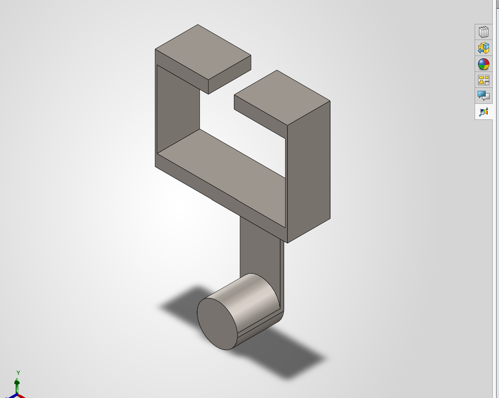

# A7 – [FEA]

## Objective

Use Finite Element Analysis (FEA) to improve the bracket design from previous assignments.

Ensure high stiffness, strength, and lightweight optimization through iterative design.

Conduct multiple FEA simulations, refining geometry based on results.

Perform static stress analysis, including constraints, loading, and meshing selection.

Interpret data by identifying max stress, displacement, and safety factors.

Optimize the design by modifying geometry to enhance performance.

Document the entire process with images, calculations, and insights.

Reflect on key engineering lessons learned and time spent.

Task is simply to create a high stiff, high strength, and lightweight component. Use Finite Element analysis to drive decision making process throughout the design. Each step of the analysis and before a geometric change is made make sure the component’s results (stress/displacement/Safety Factor) converge on a 7% difference. Achieve this by modifying the number of elements. If after three attempts to converge use the stiffness and stress from the finer mesh size use the finest mesh size and proceed through the process.

##Bracket Design

 

## Analyze

| Design 1| Test 1 | Test 2 | Test 3|
|  :--- | :--- | :--- | :---|
| Max Stress    | --- | ---| ---|
| Max Stress Location | --- | ---| ---|
| Max Displacement | ---| ---| ---|
| Max Displacement Location| --- | --- | --- |

## Decide

## Communicate

