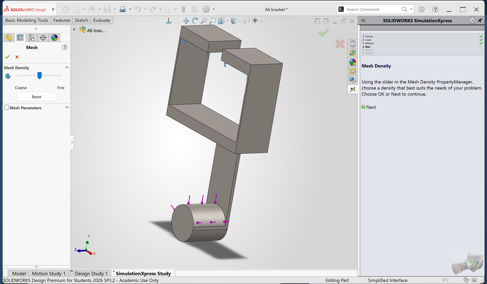

# A7 – [FEA]

## Objective

Use Finite Element Analysis (FEA) to improve the bracket design from previous assignments.

Ensure high stiffness, strength, and lightweight optimization through iterative design.

Conduct multiple FEA simulations, refining geometry based on results.

Perform static stress analysis, including constraints, loading, and meshing selection.

Interpret data by identifying max stress, displacement, and safety factors.

Optimize the design by modifying geometry to enhance performance.

Document the entire process with images, calculations, and insights.

Reflect on key engineering lessons learned and time spent.

Task is simply to create a high stiff, high strength, and lightweight component. Use Finite Element analysis to drive decision making process throughout the design. Each step of the analysis and before a geometric change is made make sure the component’s results (stress/displacement/Safety Factor) converge on a 7% difference. Achieve this by modifying the number of elements. If after three attempts to converge use the stiffness and stress from the finer mesh size use the finest mesh size and proceed through the process.

##Bracket Design

 

## Analyze

| Design 1| Test 1 (Coarse  Mesh) | Test 2 (Default  Mesh) | Test 3 (Fine Mesh)|
|  :--- | :--- | :--- | :---|
| Max Stress    | 3.306e+09N/m^2 | 3.619e+09N/m^2 | 4.360e+09N/m^2 |
| Max Stress Location |  | | |
| Max Displacement | 3.848e+01mm | 3.892e+01mm | 3.928e+01mm|
| Max Displacement Location|  |  |  |
| Mass(lbs.) | 0.77 | 0.77 | 0.77 |
|Min Factor of Safety| 7.561e-02 | 6.908e-02 | 5.734e-02 |
|FOS location|  |  |  |
| Number of Elements| 1533 | 8391 | 52197 |
|Convergence Stress| NA | 9.47% | 20.48% |
|Convergence Deflection| NA | --- | --- |
|Convergence Safety Factor| NA | --- | --- |

| Design 2| Test 1 | Test 2 | Test 3|
|  :--- | :--- | :--- | :---|
| Max Stress    | 1.953e+08N/m^2 | 2.690e+08N/m^2 | 6.799e+08N/m^2|
| Max Stress Location |  |  |  |
| Max Displacement | 1.442e-01mm | 1.506e-01mm| 1.529e-01mm |
| Max Displacement Location|  |   |   |
| Mass (lbs) | 0.86  | 0.86 | 0.86 |
|Min Factor of Safety| 1.280e+00 | 9.293e-01 | 3.677e-01 |
|FOS location|  |  |  |
| Number of Elements| 1670 | 8361 | 56807 |
|Convergence Stress| NA | --- | --- |
|Convergence Deflection| NA | --- | --- |
|Convergence Safety Factor| NA | --- | --- |

design3foscoarsemesh.png
design3deflectioncoarsemesh.png
design3stresscoarsemesh.png
design3fosdefmesh.png
design3deflectiondefmesh.png
design3stressdefmesh.png
design3fosfinemesh.png
design3deflectionfinemesh.png
design3stressfinemesh.png

| Design 3| Test 1 | Test 2 | Test 3|
|  :--- | :--- | :--- | :---|
| Max Stress    | 1.752e+08N/m^2 | 1.797e+08N/m^2 | 1.404e+08N/m^2 |
| Max Stress Location | --- | ---| ---|
| Max Displacement | 3.757e-02mm | 3.780e-02mm | 3.831e-02mm |
| Max Displacement Location| --- | --- | --- |
| Mass(lbs) | 1.31  | 1.31 | 1.31 |
|Min Factor of Safety| 1.427e+00 | 1.391e+00 | 1.780e+00 |
|FOS location| --- | --- | ---|
| Number of Elements| 8702 | 15537 | 61250 |
|Convergence Stress| NA | --- | --- |
|Convergence Deflection| NA | --- | --- |
|Convergence Safety Factor| NA | --- | --- |

## Decide

## Communicate

