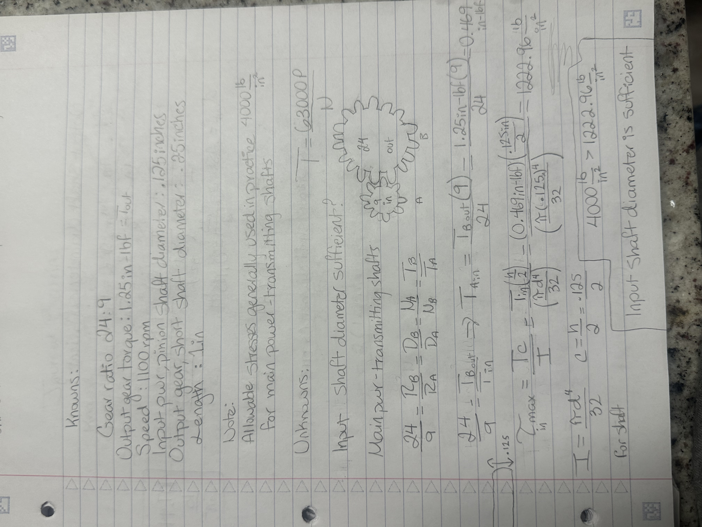
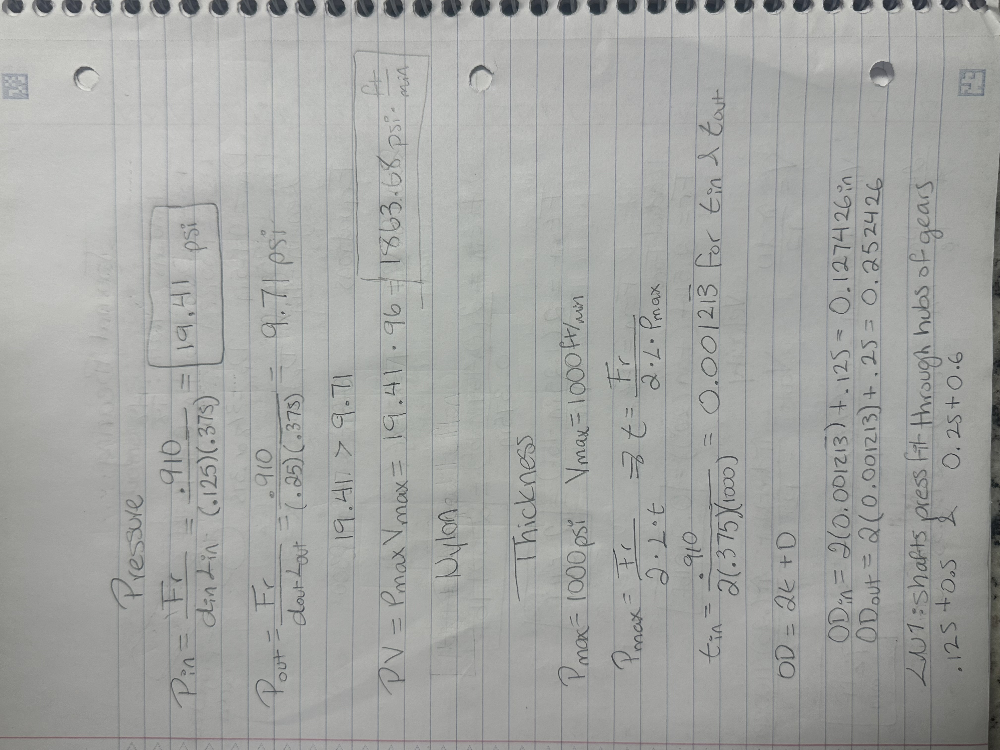
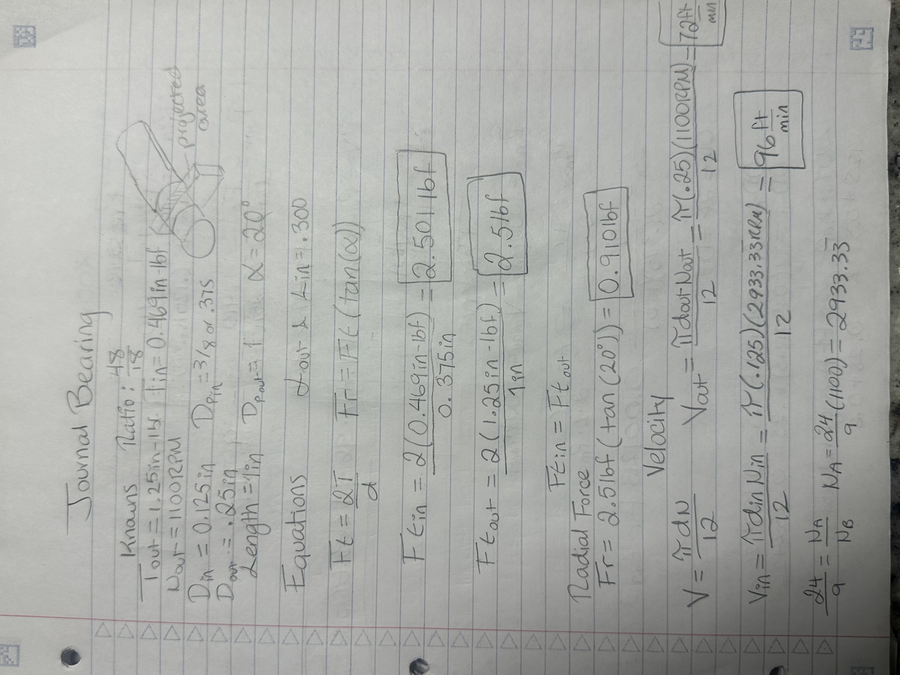
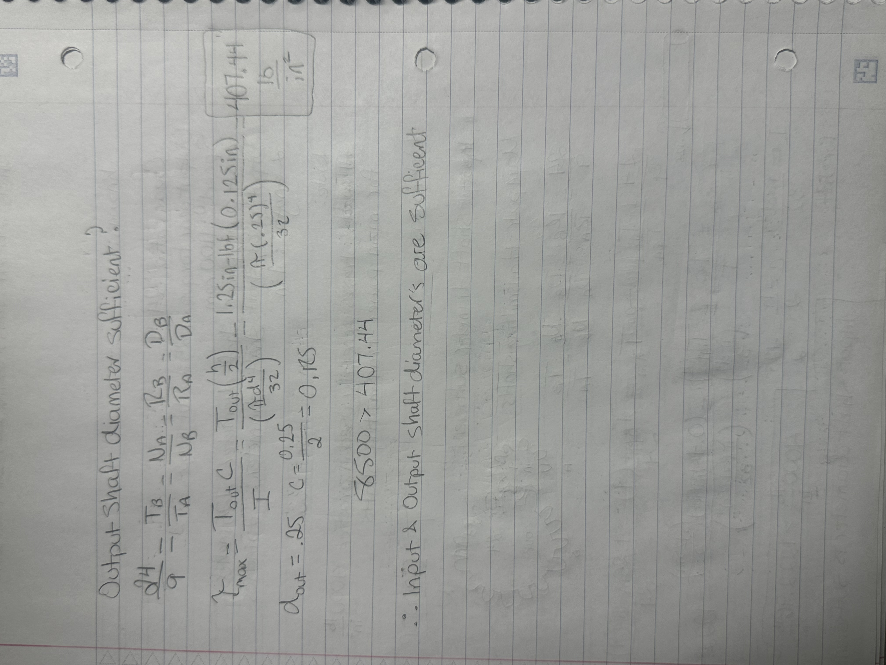
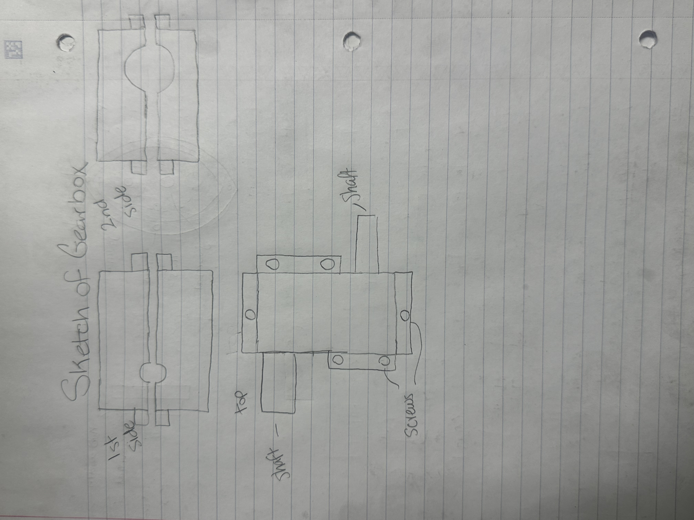

# A8 – Gears

## Objective

Design a gearbox which can be assembled and disassembled. The spur gears have a gear ratio of 24:9 and are listed in the resource section. The output gear torque and speed are to be 1.25 in-lbf and 1100 rpm relative. The input (pinion,power-transmission) and output (gear, short shaft) shaft diameters are .125 and .25 inches respectively and each have a length of 1 inch. Use the appropriate equations in the Machinery’s Handbook for empirical units. The critical features of the gearbox include the shafts, and the journal bearings.

Assumptions: 

Assume appropriate strength of shafts, use Machinery’s Handbook.
The gear train is ideal.
The moment of the radial force from the gear train is small enough to be ignored.
Note:

The shafts are press fit through the hubs of the gears.
Make sure there is enough clearance between the gears and the gearbox.
Use a running sliding fit for the size of the hole for the shafts.

## Input Shaft 

## Output Shaft

## Journal Bearings

## Journal Bearing Material Selection

## Journal Bearing Thickness

## Housing Sketch

## CAD Model

 
 
 
 
 
 
 
 

## Decide

## Communicate

