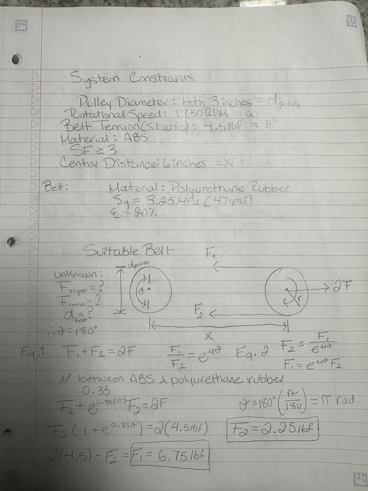
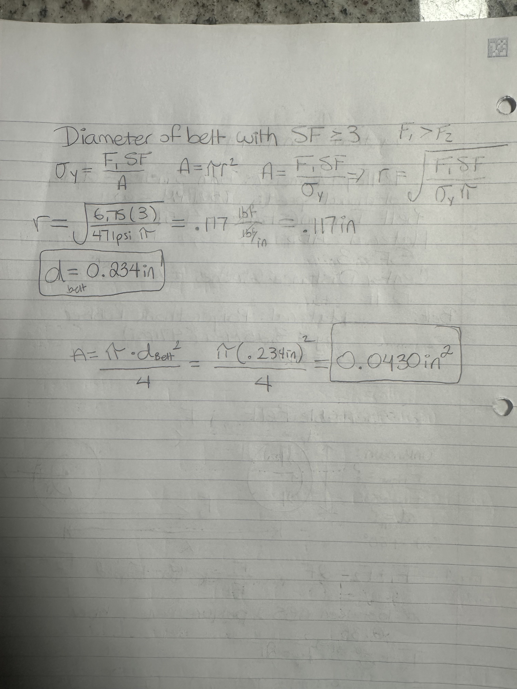
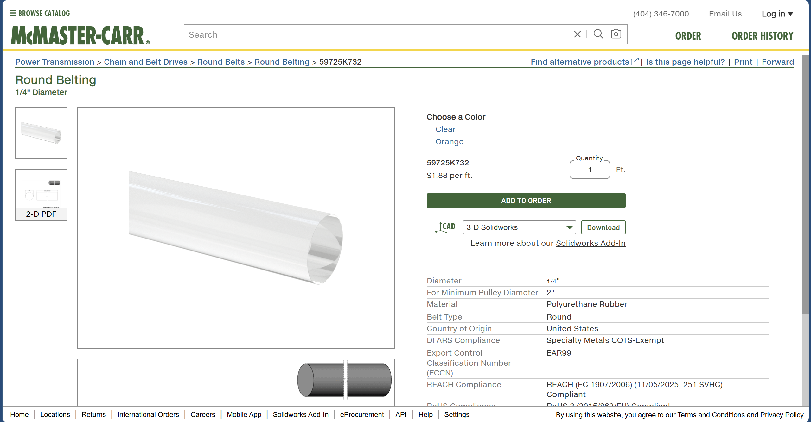
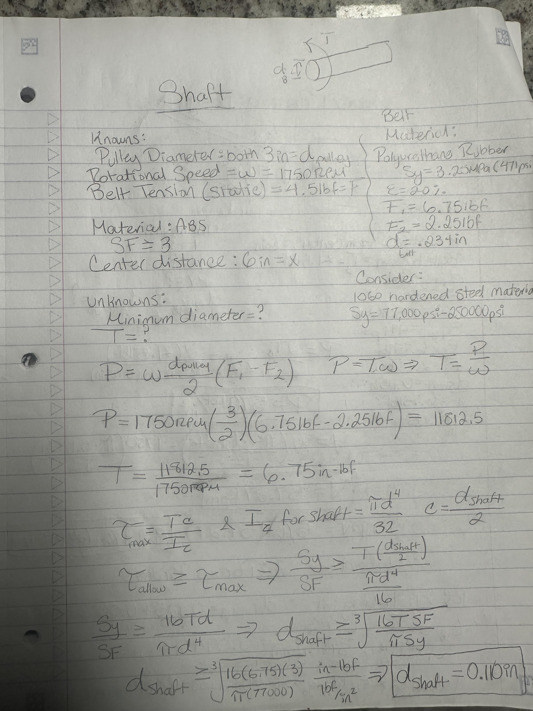
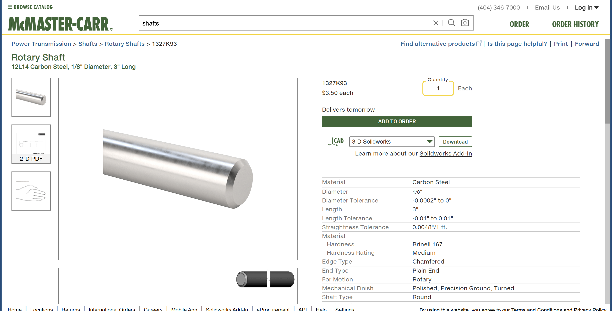
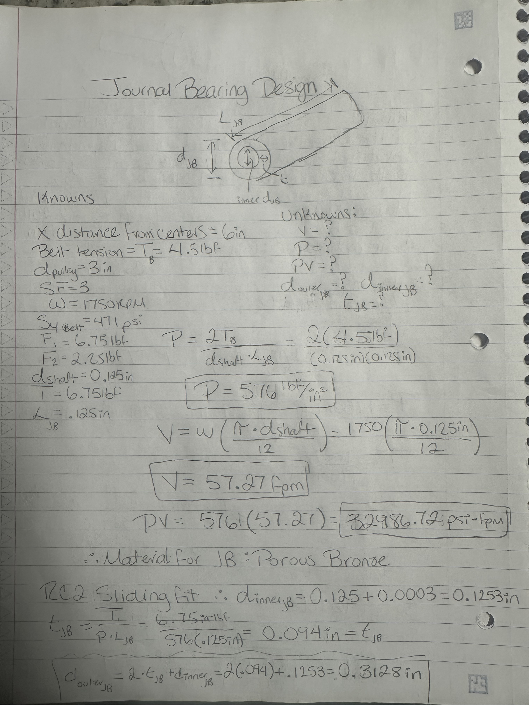
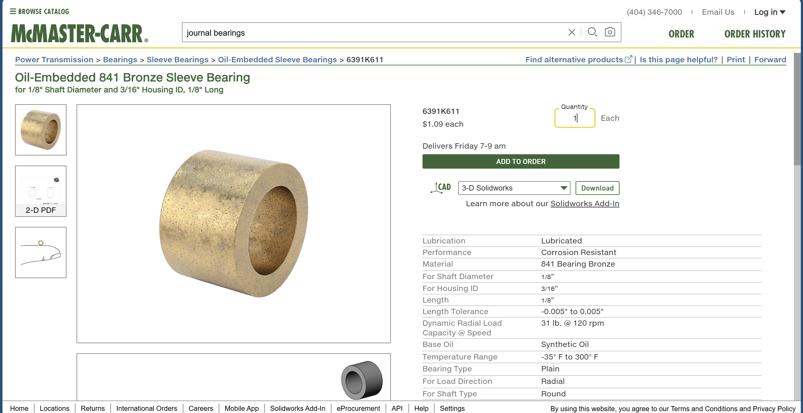
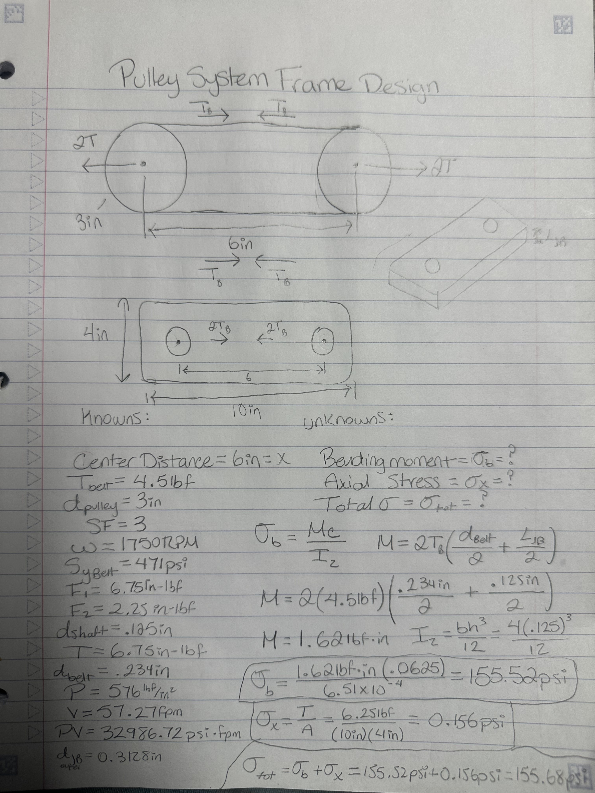

# A9 – Pulleys

## Objective

Design a pulley system to transfer power between two parallel axes separated by a center distance of 4–6 inches. The system must meet the following requirements:

Pulley Diameter: Both pulleys shall have a diameter of 3 inches.
Rotational Speed: Select an operating speed between 1000–2000 rpm.
Belt Tension (Static): Select a belt tension between 4–6 lbf under stationary conditions.
Material: Pulleys may be made from aluminum, ABS, or steel, and may include a groove and shaft diameter of your choosing (within reasonable manufacturing limits).
Safety Factor: The design must satisfy a minimum safety factor of 3.
Assume the belt is made from polyurethane rubber, with a yield strength of 3.25 MPa (471 psi) at 20% strain, based on: Wanga, Chena, Wua, Zhangb, Suna, “Strain-induced Structural and Dynamic Changes in Segmented Polyurethane Elastomers.”

## Belt Design

To start I listed all my knowns and unknowns, I drew a free body diagram to visualize the concepts. To find the coefficient of friction between ABS and polyurethane rubber I had to use AI. My prompt to AI was "What is the coefficient of friction value between an ABS material pulley and polyurethane rubber, considering no slippage". Since I had more than one unknown in the equation, I had to solve for a force in equation 2 so I can substitute it into equation 1. This is how F1 and F2 for the belt was found. To find the diameter of the belt I used the equation for diameter design which takes into account the safety factor. Since the minimum belt diameter is 0.234in a 0.250in belt diameter was selected, made of polyurethane rubber.

## Shaft Design

To find the diameter of the shaft by first calculating the power transmitted by a belt drive system and then using the power formula and rearranging for torque, now that the power value is known. After calculating for the torque experienced by the shaft the max shear stress formula can be used. The max shear stress and the allowable shear stress formulas can be related so the desired safety factor value can be used. Note, the allowable shear stress must be less than or equal to the max shear stress. After, rearranging the formula to calculate for the diameter I found the minimum shaft diameter to be 0.110in. Therefore, the decision was to select a shaft 1/8 in diameter. Also, I selected the carbon steel material because after treatment it is 1060 hardended steel.

## Journal Bearing Design

 

## Frame Design

 ## Engineering Lesson

